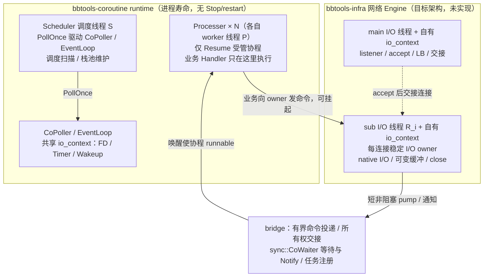

# bbtools-coroutine 核心运行时契约

**状态：** M1 已确定的目标契约（2026-09-07）
**权威级别：** 核心框架设计与实现的唯一契约真源
**适用范围：** 核心运行时层；工具层规则见下文边界；与上层独立网络 I/O 域的执行域边界见 §11（目标架构）

> 本文记录已经确定的目标语义，不等同于当前代码已经全部实现。实现、测试、README、Agent 文档与本契约冲突时，先标记差异；未经用户确认不得用当前行为反向修改契约。

## 1. 分层

### 核心框架层

核心框架以后允许大幅替换内部实现，但尽量不改变本契约：

- 有栈 `Coroutine`；
- `Scheduler`；
- `EventLoop`；
- `CoroutineEvent`；
- `Timer`；
- `Hook Adapter`；
- 通用等待、唤醒、超时、取消和关闭机制。

### 工具层

以下属于可迭代工具层，不作为核心状态机的组成部分：

- `Chan`；
- `CoMutex`；
- `CoRWMutex`；
- `CoCond`；
- `CoPool`；
- RAII guard；
- 工具型语法宏和便利封装。

工具层优先保持兼容，但重大变化允许破坏；变化必须同步更新契约、测试和迁移说明。

## 2. 执行模型

- Go 语义优先；C++ 的异常、RAII、所有权和线程边界差异必须显式定义，不承诺 Go runtime 的抢占或自动恢复能力。
- 继续采用有栈协程；本阶段不迁移到 C++20 原生 coroutine。
- 保留当前 detached 协程模型，不强制引入 `Task/Join`。
- 支持多 worker 并行。
- 单个协程同一时刻只能在一个 worker 上运行。
- 协程挂起后允许恢复到其他 worker。
- 继续使用全局单例运行时；`g_scheduler` 是默认且当前核心设计的一部分，本阶段不做多实例。
- 协程取消采用协作式取消：运行中的用户代码不被强杀；等待中的协程可被唤醒。运行中被取消的协程经正常 C++ 栈展开和 RAII 清理。没有「取消式停机」例外：`Scheduler::Stop()` 已删除，运行时是进程寿命对象（见 §6），不存在取消式停机路径。

## 3. 异常与运行时结果

采用 C++ 异常与显式运行时状态的混合模型：

- 用户任务内部允许抛出 C++ 异常，以利用栈展开和 RAII。
- 异常不得逃出 `fcontext` 或 worker 执行边界。
- 运行时边界捕获异常，并以 `std::exception_ptr` 保存和交付。
- 对提供任务结果或 future 的工具 API，结果被取用时默认重新抛出保存的异常；这不要求核心新增 Task/Join。
- detached 任务没有接收者时，异常必须日志 + 计数，禁止静默丢失。
- `Timeout`、`Cancelled`、`Closed`、`Rejected` 等预期运行时结果使用显式状态或返回值，不强制转换为异常。`SchedulerStopped` 是**已废止（superseded）**的历史结果：没有停机入口后不存在「因调度器停止」的结果，见 §6。
- 异常回调自身抛出的异常必须被隔离，不能破坏调度器或 worker。

## 4. EventLoop 与 Poller

当前 `CoPoller` 基于 `bbt::pollevent::EventLoop`；Issue #12 P2 起 `bbt/pollevent` 已内置本仓并随 `bbt_coroutine` 一同构建，不再依赖外部 bbtools-core。M1 固定的是本项目运行时层的职责边界，不直接冻结或修改该事件层的公共 API；涉及 `bbt/pollevent` 变更时，必须同步评估运行时层契约和兼容性。

`EventLoop` 是核心稳定抽象，首版只承诺三类事件：

- FD；
- Timer；
- Wakeup。

职责边界：

- `Scheduler` 负责协程调度，不直接依赖具体 `Poller`。
- `EventLoop` 负责驱动 FD、Timer、Wakeup，并把结果交付给等待者。
- `Poller` 只负责底层就绪事件注册、删除和等待，可被替换。
- `CoroutineEvent` 负责一次等待的生命周期、状态、超时、取消、关闭和协程唤醒。
- 第一阶段只沿现有 Poller/协程事件边界做必要解耦，不提前建设多后端插件体系。
- 首个 backend 可以继续使用现有 epoll 实现，但 epoll 不属于用户契约。
- 本 EventLoop 属于 runtime 内部基础设施，只由调度驱动线程经 `PollOnce` 推进；与上层独立网络 I/O 域的关系见 §11。

## 5. Hook 契约

Hook 属于核心适配层，目标是参考 libco 的方式，尽可能将其他仓库的同步阻塞调用无损转换为当前协程等待。

- 优先透明兼容主流 POSIX 阻塞调用。
- 尽量保持原生返回值、`errno`、flags、超时、EOF、关闭和线程可见语义。
- 外部创建、进程启动前创建和第三方库创建的 FD 都属于兼容验证范围。
- `MSG_DONTWAIT` 必须保持立即返回语义。
- `SO_RCVTIMEO`、`SO_SNDTIMEO` 等 socket timeout 不能静默变成无限协程等待。
- `EINTR`、`EAGAIN`、`EWOULDBLOCK`、`EBADF`、`EOF` 等错误和边界结果不得被吞掉或误转成功。
- 无法安全转换时必须明确降级、原生直通或返回明确错误；禁止静默改变为协程等待。
- `close` 的代际/closing/waiter 摘除在准备分配完成后一次发布；准备失败不得遗留半发布状态。Hook 边界不让准备阶段 C++ 异常外泄：一次 `bad_alloc` 后只重做尚无副作用的准备，不重试可能已执行的 syscall；再次分配失败返回 `-1/ENOMEM`，其它准备异常返回 `-1/EIO`。
- 已 PARKED 等待的完成赢家在延迟销毁提交扩容失败一次时，仍持有原 Event，在同一临界区有界重做无副作用的提交，再完成唯一唤醒；不回退首胜状态，不在通知线程销毁底层 Event。本保证针对该分配点单次失败且随后内存恢复，不承诺持续 OOM、mutex 损坏、用户回调或其它调度分配失败的通用恢复。
- 是否支持某个调用，以真实兼容矩阵和客户端验证为准，不以 Hook 函数数量作为完成标准。

## 6. 运行时寿命与无停机入口

核心运行时不提供业务停机入口：`Scheduler::Stop()` 已删除，不留兼容壳，也不改名藏到退出钩子。运行时的寿命是**进程寿命（process-lifetime）**：

- 没有「停止接收新任务」状态：`RegistCoroutineTask` 只在队列/Processer 容量不足时报错；
- 不取消、不唤醒、不销毁等待中的协程；
- 不 join worker、不做运行时资源回收；
- 不提供 restart：成功初始化一次后重复 `Start`（含并发 `Start`）抛 `std::logic_error`，不重置配置/队列、不新增 worker。

运行时可观察的初始化状态是 `Scheduler::IsInitialized()`。必要时序是「worker 与 poller/config 就绪 → 发布初始化标志 → 进入运行循环」；标志在初始化完成后恒为 true，不因业务关闭归零。使用 `SchedulerStartOpt::SCHE_START_OPT_SCHE_LOOP`（`Start` 不返回）时，这是外部唯一能观察到初始化完成的时刻。

运行时及其依赖（poller、全局配置、Scheduler 单例、DNS worker 池）按同一进程寿命策略不在静态退出期析构：删除 Stop 后静态析构会直接销毁仍被 worker 线程使用的对象，因此单例由刻意泄漏的持有者维持，且不使用 `std::thread::detach` 代替对象寿命论证。

旧契约中「`Scheduler::Stop()` 对仍挂起协程直接销毁、不做栈展开」是**已废止（superseded）**的历史语义（2026-09-12 #338 的用户决策）：当前实现没有 Stop 路径，因此该例外不再存在。挂起协程「不做栈展开」只是「不存在业务停机」的推论；协程级取消仍按 §2 协作式取消执行，等待中的协程可被唤醒并经正常路径返回。

工具层（例如 `CoPool`）的停止与排空语义独立定义，不依赖运行时停机：`CoPool::Release()` 不再把「运行时正在停机」当作等待逃生条件，普通线程与协程调用路径都必须在池排空期间维持进展。

## 7. 用户入口

- 保留 `bbtco`、`bbtco_sleep`、`bbtco_yield` 等宏，降低迁移成本。
- 稳定契约落在 C++ 类型和函数 API。
- 宏只做薄封装，不承载额外生命周期语义。
- 以后新增或修正宏时，必须能映射到已有稳定 C++ API，不得由宏偷偷引入另一套状态机。

## 8. 故障暴露与诊断

核心运行时必须满足“允许故障，但不能静默失败”：

- 异常、Hook 失败、取消和关闭都必须有可观察结果。
- 最小协程现场包括：协程 ID、业务描述、状态、等待类型、等待对象和等待时长。
- 应能识别 worker 长时间无进展、用户死循环和外部 blocking FD 导致的调度停顿。
- 普通运行路径保持低开销；严格调试和详细 Profile 可作为增强模式。
- 不建设完整监控平台作为 M1 前置条件；先提供可靠日志、计数、快照和必要告警。

## 9. 实现优先级

M1 按以下顺序推进：

1. 协程生命周期与状态机；
2. 取消、等待唤醒、异常和 Stop 语义；
3. 稳定 C++ API 与宏薄封装；
4. EventLoop / Poller / CoroutineEvent 解耦；
5. Hook 语义保持和兼容矩阵；
6. 故障现场与 worker 无进展诊断；
7. Release 构建、工具层边界和真实客户端验收。

## 10. 变更纪律

- 核心实现可以重写，但不得未经确认修改本契约。
- 发现当前实现与契约不一致时，优先建立回归测试并记录差异，再修实现。
- 工具层可以独立迭代，但不得把工具层临时行为提升为核心契约。
- Agent 在设计、实现、审查和验证前必须读取本文；若本文与任务描述冲突，以用户最新明确决策为准，显式记录冲突与用户决策后再更新本文。

## 11. 执行域与网络 I/O 域边界（目标架构，用户已确认）

> 本节区分两类陈述：「当前事实」= 当前代码行为；「目标」= 用户已敲定、由 bbtools-infra 建设的架构。独立网络域落地并验证前两者不得互称。本章不新增任何 runtime API，不改变 §6 的进程寿命契约。

### 11.1 runtime 组成与线程模型（当前事实）

- 执行 runtime = `Scheduler` + 多 `Processer` + 有栈 `Coroutine`，以及支撑自身通用等待/唤醒/定时/取消竞争/Hook 的内部 `EventLoop`/`CoPoller`、同步工具（含 `sync::CoWaiter`）与对象寿命管理。runtime 是进程寿命单例，无 `Stop`/restart、单次初始化（见 §6）；既有 FD/Timer/Hook 能力保留在 runtime 内。
- 默认后台模式 `SCHE_START_OPT_SCHE_THREAD`：Scheduler 专属调度线程（S）经 `PollOnce` 驱动内部 `CoPoller`/`EventLoop`（FD/Timer/Wakeup，及共享 io_context 上投递 handler 的兑现），并做调度扫描与栈池维护；每个 `Processer` 绑定各自 worker 物理线程（P），只负责 Resume 受管协程。
- 非默认模式不得误述：`SCHE_START_OPT_SCHE_LOOP` 在调用者当前线程执行调度循环（`Start` 不返回，无独立 S 线程）；`SCHE_START_OPT_SCHE_NO_LOOP` 只创建 worker，由调用方 `LoopOnce` 手动 tick 驱动（含 CoPoller）。不能把所有启动模式说成恒有独立 S 线程。
- 协程挂起后可迁移 Processer，不承诺返回原物理线程或 Asio strand；线程亲和只是调度绑定，不等于 CPU affinity、内存隔离、故障隔离或实时延迟保证。strand 仅串行化执行，不保证线程隔离，也不自动约束 fcontext 恢复线程。

### 11.2 与 infra 独立网络 I/O 域的边界（目标，未实现）

- infra 网络 Engine 拥有独立 main/sub I/O 域：非 ReusePort 的 stream 模式下，main 自有线程 + 自有 io_context 只负责 listener/accept/LB/交接；每个 sub 自有线程 + 自有 io_context，独立驱动本 owner 连接。ReusePort 为可选布局（各 loop 自接纳，无独立 main）；UDP 按数据报 owner 布局，不硬套 stream accept。不是每连接一线程，也不是每 readiness 新建协程。
- runtime 线程与网络 reactor 线程分离；网络 owner 数与 Processer 数独立配置，不一一绑定。每连接一个稳定 I/O owner：native I/O、事件注册/撤销、可变缓冲、fd close/终态都在它自己的串行域推进。
- I/O 线程不运行要求受管协程环境的 Co 业务入口、不 Resume 用户协程、不接管 Scheduler；业务 Handler 只在 runtime Processer 的受管协程执行。同一连接事件至多一个活跃：可挂起，Action 返回后再回投 owner，晚到事件不能重开 Closing/Closed 连接。
- 跨域 bridge 只做有界命令投递、不可变数据/操作状态所有权交接，以及现有 `sync::CoWaiter` 等待/Notify 或任务注册：业务向 owner 发命令，必要时挂起协程；owner 只完成短非阻塞 pump/写结果/通知，由 runtime 使协程 runnable。先登记后投递，覆盖完成早于 park、超时/取消/Close 首胜、迟到 completion。不新增 `Task`/第二 runtime/`CompletionSignal`/`CancellationToken` 等不存在或已删除的 API；mutable ring 不跨域裸借，挂起不持 OS mutex。
- Engine/网络域负责自有线程及 fd 的启动、部分失败回滚、取消/排空/物理释放/join，不调用 Scheduler Stop（不存在，见 §6）。网络连接 Close(Block/Unblock) 沿 infra 新 net 契约：Block 仅受管协程可挂起等待物理完成、不等自身 OnClose；Unblock 是封口可靠投递而非释放完成。runtime 继续活到进程结束。
- 读取/写入策略（ET/LT）是上层选用的策略而非阻塞项：Asio 负责 readiness；连接层负责 drain/EAGAIN、预算续投、公平、部分写、缓冲高水位背压/恢复。Asio 公共 `async_wait` 没有 native per-fd EPOLLET 开关，经该后端兑现的策略不得宣称等价 native LT/ET 事件计数/flags。

下图为默认后台 Scheduler、非 ReusePort stream 布局示例；其他启动/网络布局见前文。

### 11.3 共享 executor 与独立 context 的区别

- `bbt::coroutine::io::GetExecutor()`（`bbt/coroutine/io/IoExecutor.hpp`）是既有共享 context 的只读投递句柄：返回 CoPoller 全局 EventLoop 所持同一 io_context 的 executor，投递的 handler 只由 Scheduler 现有 `PollOnce` 在驱动线程上兑现。对它不得再启线程 run/poll，不得 stop/restart——头文件注释中「不创建新线程/独立 io_context」的限制**仅限定共享 executor 的使用方式**。
- 该限制不是禁止上层独立网络域存在的全局规则：独立网络域使用自己拥有的线程与 io_context（§11.2），不经 `io::GetExecutor()` 投递。该目标域当前尚未实现；落地并验证前，任何文档不得声称独立网络线程/bridge/Close 已交付。
- 既有 HTTP/Redis/Mongo/config 等上层适配不在本轮网络域范围，不得宣称已切换或已验证。

### 11.4 gnet 参考事实与有意差异

- gnet（固定 v2.10.0，参考 SHA `58b59a1`）Unix 普通布局：main/sub 各 goroutine/poller；`OnTraffic` 在 sub eventloop 调用栈直接执行，不每事件派生 goroutine；goroutine 不是 OS 固定线程（`LockOSThread` 才固定 OS 线程）；ReusePort 无独立 main。
- 本项目「额外 native reactor 线程 + 受管业务协程分离」是刻意差异：固定 native I/O 线程推进连接 I/O，业务协程一律回 runtime Processer 执行。参考 gnet 结构与 API 思路，不逐字节移植，不冒充 gnet 原实现。

## 相关文档

- M1 计划：`agent-docs/2026-09-07-m1-core-contract-plan.md`
- 使用期评估：`agent-docs/2026-09-07-usage-readiness-assessment.md`
- 仓库通用 Agent 规范：`AGENTS.md`
- 网络域目标架构的 infra 侧落地（同轮更新）：bbtools-infra 仓 `docs/architecture/gnet-network-execution.md`、`docs/decisions/0010-gnet-network-foundation.md`
