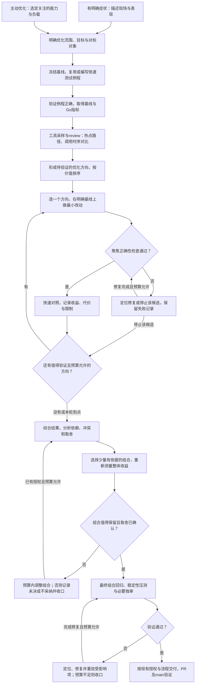

# 性能问题分析与优化指南

本文以协程切换与调度优化、对标 Go 的实践为例，介绍一套可反复执行的性能优化流程：先准备快速评价入口，通过工具与调用时序分析提出候选，再逐项实验、比较取舍，最后选择组合并做回归压测。既适用于有明确症状的问题，也适用于主动对标寻找提升空间。各阶段的专门技巧随实践逐步补充，不预设一套包治所有问题的方案。

先减少必须做的事和必须等的时间，再让剩下的事更便宜。流程与工具服务于快速验证，不取代核心契约、项目授权和开发发布门禁。本文后半部分保留既有测试配方与测量协议阈值；候选收益门是软门禁，不用本次规则更新改写历史实验结论。

> 工具交付边界：本 PR 只交付方法指南、AGENTS 阅读入口和案例结论摘要。下文 `scripts/perf-tools/`、`scripts/perf_check.py` 与 `benchmarks/compare/spotcheck/` 对应本地已有但尚未随本 PR 入库的工具／驱动，命令是该工具版本的参考，不是从本分支新检出即可执行的入口。后续工具交付并验证前，不据本指南声称已完成工具集成。

## 总体流程



两层验证不可混淆：候选阶段先跑足以保护改动的聚焦正确性检查，再比较性能；最终组合阶段再集中做完整的相关回归与计划内稳定性压测。不把最终回归拖到单个不安全候选的性能采样之后，也不要求每试一个方向就跑一遍最终压测。

图中循环只覆盖已确认范围和预算；候选或组合没有明确收益就记录并停止该项，不为凑全方向无限加测。预算耗尽、权限不足或证据无效均可直接收口，不必到交付节点才允许结束。

## 明确范围、目标与对标对象

**要弄清什么：** 优化哪种能力，在什么负载下观察，拿谁比较；不要一开始就把某种实现方案当成答案。

**怎么做：**

- 有明确症状时，写清发生条件和表现，例如多 worker 下吞吐下降；“锁竞争”暂时只是解释，不是已证事实。
- 主动优化时，先收窄关注能力。本次实践的起点是协程切换与调度效率，对标对象是 Go 和本库修改前版本，而不是笼统要求“所有业务都追平 Go”。
- 本仓候选评价采用修改前基线、候选、Go 三组对照：候选与基线判断改动是否有效，与 Go 对比帮助理解差距。Go 是参照，不是所有场景必须超越的放行线。
- 明确主目标、守卫指标和已接受的成本边界。正确性、安全和核心契约不能拿来交换性能；吞吐、尾延迟、CPU、公平性的取舍单独表达，不合成总分。
- 确定本轮范围、时间和资源预算。沿用用户已给的条件，不为开始分析新建一套台账。

**何时进入下一步：** 能说清“优化什么、如何观察、与谁比较”。尚无具体差距数字可以先测基线，不必在这里猜根因或承诺收益。

## 准备快速测试例程与基线

**要弄清什么：** 怎样低成本、反复取得关注的指标，让每个候选都能敏捷验证，而不是每改一处就临时设计一遍测量。

**怎么做：**

- 先复用现有基准、驱动和脚本；缺少代表负载时，才补最小测试例程。不要用“搭一套完整性能平台”代替当前优化。
- 定义一个操作及其完成边界，再采集吞吐、P99 和单位操作 CPU。调度例程分开观察持续 yield 与真正提交、完成短任务，避免把 yield 调用返回当成裸上下文切换指令成本。
- C++ 与 Go 尽量做同样的有效工作、采用一致的计时和完成边界，同时保留语言与调度语义差异。两侧业务结果、操作账目和预热／收口必须可检查，不能只打印一个速度数字。
- 先小规模验证例程本身：任务确实执行、没有遗漏或重复、异常输入会失败；再用它取得基线。`--smoke` 证明入口可用，不代替正式性能比较。
- 在修改前冻结源码、驱动和构建条件；未提交差异也属于真实基线。随后复用同一评价入口和指标定义，保留逐轮结果及失败，不挑最好样本。
- 默认使用现有 `scripts/perf-tools/` 的 prepare / run / replay。具体场景、预算与判据见后半部分；快速筛选不等于统计显著或长时稳定认证。

**本次例子：** `cpu-short-v1` 与 `yield-steady-v1` 分别观察任务创建／调度和持续让出执行权的成本，Go 与本库使用对等驱动。它们用于区分场景，不把某个场景快了写成整体运行时都更快。

**何时进入下一步：** 已有可运行、完成口径可信的评价入口和明确基线；新候选可以沿用该入口，不必重造测试工具。

## 用工具和review分析，形成候选方向

**要弄清什么：** 性能成本在哪里，哪些流程差异可能解释差距。这个阶段产出的是假设，不是已经兑现的收益。

**怎么做：** 两种分析互相补充，不机械要求每轮把所有工具跑一遍。

- **热点路径分析：** 使用 CPU 采样、火焰图等工具，查看 CPU 花在什么调用路径。本次 CPU 短采样（perf 归档运行 20261027-411-cfs-cpu-profile，摘要见 perf-baseline 分支）给出了锁、callable／分配、时钟和 global 路径的线索，同时明确保留调用链缺失与采样范围限制。热点占比不是可直接回收的收益，也不能单凭占比变化判断绝对成本变化。
- **调用时序与对标review：** 对照 Go 的调度机制和本库实际调用链，画出提交、入队、执行、yield／park、唤醒、恢复的时序，查找额外等待、共享交接和重复步骤。Go 的不同路径不是天然正确答案，要核对语义与适用前提。

分析时优先沿以下方向检查：

| 方向 | 要问的问题 |
|---|---|
| 等待与进展 | 明明已有工作或事件就绪，为什么还在等待？是否有任务得不到机会？ |
| 所有权与交接 | 本地能完成的事，为何绕全局队列或跨线程交接？ |
| 工作频率 | 查询、维护、通知是否被不必要地重复执行？ |
| 单次成本 | 日志关闭后是否仍格式化？是否有多余复制、分配或时钟读取？ |
| 同步结构 | 是否真的竞争或昂贵？减少交接和调用次数后，仍需要更复杂的锁或容器吗？ |

时序判别示例，来自 R4 收益与代价核对（perf 归档运行 20261026-411-benefit-cost，摘要见 perf-baseline 分支）：

```text
原路径：事件就绪 → 调度线程仍在定时休眠 → 下一拍发现 → 唤醒协程
候选路径：已监听事件就绪 → 有界事件等待提前返回 → 派发并唤醒协程
```

这个差异提出了“减少就绪后的等待”的方向，但不预先证明 CPU 更省。热点已明确时直接提出候选，不重复展开全面调查。

**何时进入下一步：** 得到若干可检验的方向，每个方向能说明“怀疑什么机制、准备改变什么、预期哪些指标变化、可能付出什么代价”。按预期价值和验证成本排序，不把候选清单当成必须全部实现的承诺。

### 按问题选工具，而不是先画火焰图

先看墙钟、完成量和整个进程 CPU 时间：平均占用核数很低但延迟很高时，优先怀疑等待、串行依赖或进展问题；接近可用计算容量时，再重点检查执行成本与竞争。它们只是分流线索，不能单凭占用率确定根因；worker 数不等于整个进程的线程数或可用 CPU 配额。

| 想回答的问题 | 优先工具／方法 | 关注的数字或现象 | 解释边界 |
|---|---|---|---|
| CPU 到底花在哪里？ | 已可用的 `perf record/report` 或 `gprofng`，再按需要生成火焰图；先做短预检确认有有效样本 | self／inclusive 样本、调用链缺失、采样丢失；与同窗 CPU/op 合看 | 用户态 CPU 采样看不到未运行的等待；inclusive 有嵌套，不能把各层相加；本次历史 gprofng 取样曾失败，不保证可替代 perf |
| 是等待事件，还是就绪后排不上 CPU？ | 少量阶段时间戳；可用且获准时再使用调度／off-CPU tracing；辅助读取 `/proc/PID/task/TID/schedstat` | submit→执行、park→事件就绪、就绪→resume；线程 runqueue 等待增量 | runqueue 等待不等于协程队列等待或 I/O 阻塞；跨线程累计不等于请求延迟；无法可靠观测就绪点时明确缺口 |
| 是否有频繁 OS 交接或宿主干扰？ | `getrusage` 的自愿／非自愿切换计数；可用的 `pidstat -w -t`；线程 `/proc/.../status`、CPU PSI | 同窗切换次数/op、逐线程 CPU、CPU pressure 与运行前后环境 | OS 上下文切换不等于协程切换；PSI 是系统／cgroup 压力线索，不能直接归因；读线程集须处理线程出生与退出 |
| Go 自己为何等待或扩展不好？ | 诊断驱动接入 `runtime/trace`、`runtime/pprof`；已有 trace/profile 用 `go tool trace/pprof` 离线分析 | goroutine 阻塞／解除阻塞、处理器活动、syscall／GC、CPU 热点；必要时加业务阶段标注 | trace 不自动证明跨语言阶段完全等价；独立程序需要显式接入采集，不能凭空加 CLI 参数；不要为分析开放 HTTP profile 端口 |
| 是分配和复制，还是锁竞争？ | 已有机制计数探针；有条件时用分配分析器；锁等待／持有时长与调用次数诊断 | allocations/op、bytes/op、复制／移动次数、锁获取与竞争次数、等待／持有分布 | 分配器覆盖域和插桩开销须说明；`futex` 热点不能直接认定某个业务锁是根因；RSS 不变不等于没有分配 |

这些是选择指南，不是本轮已安装、已接线或已执行的能力。先确认工具版本、已有可执行文件路径、内核支持和权限；Linux／WSL 取样失败、计数不可用或调用链不完整时报告限制，不提权、不改 `perf_event_paranoid`，也不把缺样本当作零成本。Go 使用已有的 `GO_BIN`；诊断入口变化应保留新身份。所有诊断负载仍经过宿主共享验证队列，并与未插桩收益样本分开。

工具语义参考：[Linux schedstat](https://docs.kernel.org/scheduler/sched-stats.html)、[Go runtime/trace](https://pkg.go.dev/runtime/trace)、[Go runtime/pprof](https://pkg.go.dev/runtime/pprof)。现有工具的可用性须运行前确认，本文不复制官方安装步骤。

### 对比时额外看哪些数字

以下派生数字用于解释，不新增放行阈值，也不要求默认驱动已输出全部诊断数据。

| 数字／比较 | 怎么取 | 用来判断什么 |
|---|---|---|
| 平均占用核数 | 同窗进程 user+system CPU 秒 / elapsed 秒 | 是算力接近用满，还是大部分时间没在执行；进一步拆线程才能定位忙闲分布 |
| 同版本单／多 worker 扩展 | 同负载下 `Q2/Q1` 为加速比，`Q2/(2×Q1)` 为双 worker 扩展效率 | 先看每一臂自身扩展，再看跨语言比值；低效率可能来自共享、工作粒度或宿主约束，不自动证明锁竞争 |
| 同臂跨轮波动 | 查看每轮数值、范围及运行顺序，再看同轮候选/基线变化方向 | 小变化是否可能被噪声覆盖；极差不是置信区间，不代替现有筛选规则。微小收益若需专门 A/A，另定预算，不自动加采 |
| 进展与公平性 | 逐 actor 完成量及服务量、ready 等待分布、是否有零进展任务 | 分清按次数与按服务量公平；最大/最小完成比只适合同类任务，短窗全部进展不证明长期无饥饿 |
| 热点绝对成本估计 | 同一诊断样本中，以匹配范围的 self CPU 样本份额 × 对应 CPU/op 估计 | 百分比上升不一定是绝对成本上升；用户态份额应配用户 CPU，不能无说明乘总 CPU；不混用不同版本或不同运行的数字归因 |

CPU/op 与吞吐并非两份独立证据：同窗定义下，`CPU秒/op = 平均占用核数 / ops/s`。若各臂都接近相同 CPU 占用，CPU/op 改善会近似反映吞吐提高；仍然要报告它，但不能再当作额外的因果证明。

现有固定在途数量属于闭环负载：完成后才继续提交，慢时会自然减少到达率。其 P99 有效，但不代表固定到达率下的服务尾延迟；吞吐、平均延迟与在途量也相互关联，不能用吞吐倒数推算并发请求的平均延迟，更不能推算 P99。若要比较相同到达率／相同吞吐下的 CPU 与排队延迟，需另行准备支持按计划到达、记录计划时间及过载／拒绝的驱动，避免遗漏服务变慢期间本应到达的请求；现有 quick 协议不提供这项能力。

### 场景示例：看到什么，再查什么

下面是建议的判别路径，不代表这些诊断或新负载已执行。每次只选能回答当前问题的场景，不全部堆进默认矩阵。

| 看到的现象 | 先做什么对比／观察 | 想区分的方向 |
|---|---|---|
| I/O 很慢，但平均占用核数低 | 对照基线／候选的 park、事件就绪与 resume 时序，保留同 payload、并发及完成边界 | 事件尚未就绪，还是就绪后仍等扫描或投递；R4 历史案例展示后者，不能只靠 CPU 火焰图找它 |
| yield 在双 worker 反而更慢 | 各版本分别比单／双 worker，再查 global 往返、通知、线程等待和实际迁移次数 | 本地轮转成本、跨线程同步，还是宿主 CPU 排队；Go 自己扩展差也会放大候选/Go比值，不等于本库普遍领先 |
| yield 快了，短任务反而慢 | 用同一组基线／候选分别跑持续 yield 和真实短任务提交；再用计数诊断创建、复制、分配与记账 | 优化是否只利于存量协程，而增加任务创建或首投成本；不能用一种负载替另一种做结论 |
| 本地吞吐很高，但外部任务等不到机会 | 在持续 yield 背景下受控提交外部任务，并观察其真实开始执行；混合长短任务时另看服务份额 | 吞吐是否以饥饿为代价；提交成功、入队成功不代表已执行，不能只看最终总完成数 |
| 吞吐提高，同时单位 CPU 更贵 | 先核同窗占用核数和每 op 成本；有对应新驱动时再做同吞吐／固定到达率对照 | 多干了活与每次更费 CPU 是两笔账；R4 的历史取舍不能替本轮用户决定 |


## 逐项循环论证与快速对照

**要弄清什么：** 单个方向实际有没有价值，收益和代价各是什么；不能靠代码看起来更快就采纳。

**怎么做：**

- 优先让相互独立的候选从同一个冻结基线出发，一次改变一个机制包。不是试出一个好结果，就默默把它叠进所有后续候选。
- 有前置依赖的候选显式写出依赖；确需将已接受改动作为新基线时，冻结并标明新身份。不同基线下的收益不能直接相加或当作同一组实验。
- 技术选择不清楚时先做有界隔离原型；否则直接做最小改动。原型证明机制，不替代运行时接线与对象寿命验证。
- 每个候选先做必要的正确性检查，保护等待／唤醒、取消、外部投递、迁移和退役等实际受影响行为；不通过就先定位，不能拿吞吐数字作为安全证明。
- 用已准备的快速例程做同轮对照，分别记录吞吐、尾延迟、单位 CPU 及相关守卫，不把诊断插桩版本当成正式收益版本。
- 记录基线与候选身份、改了什么、逐轮指标、错误与未覆盖项，并给出“值得组合验证／不采纳／尚未决定”的结论。复用现有结果文件，重要结论按仓库规范归档，不另造台账。
- 对其余值得验证的方向重复这一过程；预算内可以逐项跑完本轮选定方向，不要求穷尽所有想法。未通过、无收益或无效证据分别保留原因，不反复补测凑绿。

**本次例子：** 格式化与直接交接判别（perf 归档运行 20261027-411-yield-diagnosis，摘要见 perf-baseline 分支）分别测试关闭日志时跳过格式化与单项 refill 直接接手，没有把两者捆在一起解释。前者建立了部分场景的收益，后者未建立双 worker 稳定收益。查询与批量锁实验（perf 归档运行 20261027-411-cfs-lock-experiment，摘要见 perf-baseline 分支）同样分别比较候选，未因“少一次锁”就自动采纳。owner-local 第一版（perf 归档运行 20261027-411-owner-local-r1，摘要见 perf-baseline 分支）因正确性与接线缺口没有进入性能采样；它否定该原型，不等于否定整个方向。

**何时进入下一步：** 本轮选定候选已有可复核结论，或预算已到、需要收口。未测项明确留空，不强行让每个方向都有成功结果。

## 分析取舍，选择并验证组合

**要弄清什么：** 哪些改动可以共同工作，是否互相抵消、重叠或引入新代价。目标是一组值得保留的改动，不是最多的改动。

**怎么做：**

- 根据单项结果筛选组合，检查依赖、互斥、重复优化和共同维护成本。只挑少量有依据的组合，不枚举所有排列。
- 组合是新候选，必须实际运行快速对照；既比较原始基线，也按需要比较已保留版本。单项收益不能直接求和，组合也可能改变原来的瓶颈。
- 某个指标改善、另一个退化时，保留风险提示并按既定目标判断；超出已接受边界交用户决定，不能事后改阈值掩盖退化。
- 没有证据就不归因于某一种算法；组合收益可以成立，但组成部分的成本份额仍可能未知。
- 如果需要回答“组合里哪项仍有价值”，优先做少量有依据的消融：比较完整组合与去掉一项后的合法组合。两个可独立开关的机制可考虑基线、仅 A、仅 B、A+B；有依赖时不能强拆，更不能关闭公平性、寿命或安全保护来制造更快的比较臂。
- 消融得到的是该组合条件下的边际影响，不是每项固定可相加的贡献，也不证明唯一最优。只有会改变采纳决定时才做，并另列入既定实验预算；不要求每个组合都展开全排列。


**本次例子：** CFS 真实接线对比（perf 归档运行 20261027-411-cfs-runtime，摘要见 perf-baseline 分支）同时包含排序、READY 本地回队、轮次与同步调整。历史双 worker yield 吞吐改善明显，但短任务吞吐与 P99 有代价；不能把收益全部归给 CFS 树，也不能宣称全面优于 Go。各阶段精确数字留在原报告，不跨基线累加。

**何时进入下一步：** 组合性能已测，值得保留，所需取舍已明确接受。否则在预算内缩减或调整组合，或以不采纳／未决结论结束本轮。

## 最终组合回归与稳定性压测

**要弄清什么：** 快速例程中的收益，是否伴随功能、竞争安全或稳定性退化。快速对照只能筛选候选，不能证明功能完整性与长期稳定。

**怎么做：**

- 在最终组合源码上集中运行冒烟、本次功能及直接耦合单测；完整 CTest 走 PR CI，不在本地重复全量验证。
- 按改动风险和已确认计划做稳定性压测，检查错误、超时、崩溃、进展及必要资源趋势。固定源码、命令、负载、时长与通过标准；短压测不能冒充长期无泄漏或无饥饿证明，长 soak 不能自动追加。
- 证据绑定最终组合，不用单项旧版本结果冒充最终树。出现失败则定位、修复并重验受影响项；失败保留，不能只报后一次绿。
- 独立审查、提交、PR、CI、main 集成与发布遵循[开发与发布流程](development.md)和授权，不在本文复制或放宽门禁。

**何时完成：** 计划内验证具有真实完整结果，未覆盖范围与剩余风险写清；开发完成、已提交、已合并、可发布分别陈述，不混为一个“通过”。

## 与 OMH 和现有工具的分工

- `ulw-perf` 组织基线、假设、最小改动、复测及回归代价；候选循环服务于本轮目标，不无限扩展。
- `omh-decision-prototype` 仅用于单个不确定选择的有界隔离实验，不是每个候选必须增加的步骤。
- OMH 负责编排、委派与验收组织；仓库负责具体方法、工具接线、授权和交付门禁。不要求安装 OMH 才能使用本指南，不向仓库加入工具专属任务状态。
- 以下是现有工具与测量协议的查阅区。具体时长、矩阵、阈值及失败处理以各用途对应协议为准；修改报告优先 replay，不为文档整理重新采样。

## CPU 调度场景（cpu-scheduler-v1）

这是新增的局部工作负载套件，不修改旧 `coroutine-quick-v1` 内容指纹或完整矩阵资格。

| case | 形状与工作 | 一个 op / P99 边界 |
|---|---|---|
| `cpu-short-v1` | 窗外创建 1 个提交 actor；窗内逐任务真正 `RegistCoroutineTask` / `go func`，最多 16 个逻辑在途，整批收齐后复用预分配结果、时间戳和代际槽 | 任务结果发布完成；提交调用前到任务体写结果后的完成时间戳，不含提交 actor 之后的合并时间，但合并成本仍在总窗内 |
| `yield-steady-v1` | 窗外预创建 16 个 actor；每 actor 反复 `bbtco_yield` / `runtime.Gosched()` | 本 actor 一次 yield 调用及返回；紧邻调用前到返回后首个时钟观测点，包含一次轻量请求计数，不是底层切换指令成本 |

两场景固定 `inflight=16`、`payload_bytes=8`；后者是不适用的兼容参数，不偷换为计算轮数。短任务 `integer-mix-256-v1`：`x=id+0x9e3779b97f4a7c15`，重复 256 次 `x^=x>>30; x*=0xbf58476d1ce4e5b9; x^=x>>27; x*=0x94d049bb133111eb; x^=x>>31`，全部 uint64 wrapping。yield 只在返回后的辅助路径分配 ID、更新 `id ^ 0x9e3779b97f4a7c15` 的轻量 sink，不重算 256 轮工作。两者实际结果均折叠至可见 `work_checksum`，与实际 ID 求和的 `checksum` 分开。

全部 actor ready 后宿主读取 CPU/单调时钟再 release，ready 前必须零业务；正式窗按时长停止新操作，并将最后一个操作、已接纳短任务及 helper 的逻辑 drain 包含在同一 elapsed/CPU 窗内。预热使用独立 phase，收齐后重新分配/清零正式状态。只有 done 同步成功后才合并普通槽、逐 actor `log2-128-v1` 直方图及工作摘要；失败/超时没有成功快照，不读取仍在写的普通字段。C++ task 持有堆上状态强引用，不引用已返回的栈局部；不新增 runtime Stop，也不声称逻辑 done 等于 Coroutine、栈或 Go GC 全部物理回收。

新账目必须满足 `submitted=accepted=completed`、拒绝/重复/遗漏为 0、ID 求和模 2^64 与独立参考一致、直方图样本数=完成数；另核实际 task body 数、yield 请求/返回、ready/done 和逐 actor 进展。reader 核对工作摘要的逐 actor 折叠，不将正式大样本自报摘要当逐项独立参考。每 op 两个延迟时钟读数、一次桶增量；另外包含开始门、原子计数、批次协作与合并成本，不扣除或宣称辅助成本为零。正式辅助内存有界于 16 个槽和 actor 数×7424 桶。

调度组为两场景×1/2 workers，共 4 维度。保留三轮三臂轮转、1 秒预热/8 秒正式窗及三臂各 5 秒 idle：36 个活动样本，连 idle 名义 339 秒，实际正式总截止仍为 600 秒。主场景预先固定 `cpu-short-v1/2`，其它为直接耦合守卫；本批驱动联调仅使用 `--smoke`，不启动正式矩阵或声明收益。

首次建立 base/Go 基线使用显式 `run --baseline-only`。它只复用 prepare 已冻结并构建的 base/Go，不快照当前工作树、不构建或生成 candidate，也不改写 prepared 状态。suite 保留原三臂轮转；每轮删除 candidate 后依次为 `base → go`、`go → base`、`go → base`，idle 也仅 base/Go。CPU 套件仍为 4 维度、三轮、1 秒预热/8 秒正式窗和每臂 5 秒 idle：24 个活动样本加 2 个 idle，名义 226 秒，实际正式截止仍为 600 秒；不为凑时长增加负载。此用途不依赖 partial 标记，结论仅为 `BASELINE_OBSERVATION`，不判定候选收益或退化；未来真实候选仍用默认三臂同轮比较。

在项目根目录，先核对可用内存、既有任务和宿主共享验证队列；构建/测试/负载均经该既有入口，配置使用 ccache，编译显式最多 2 并发。示例变量均应替换为已存在的绝对路径：

```bash
# R4 必须是包含其 tracked dirty 的完整工作树，不以裸 HEAD 代替。
# VERIFY_QUEUE 是宿主已有 verify_queue.py；GO_BIN 是已有 Go，不下载/安装。
python3 "$VERIFY_QUEUE" --label cpu-prepare --run-timeout 600 --wait-timeout 180 -- \
  python3 scripts/perf-tools/perf_check.py prepare --base-source "$R4" \
  --suite scripts/perf-tools/suites/cpu-scheduler-v1.json \
  --build-root build-perf-cpu-driver-check --go "$GO_BIN" --jobs 2
python3 "$VERIFY_QUEUE" --label cpu-smoke --run-timeout 180 --wait-timeout 180 -- \
  python3 scripts/perf-tools/perf_check.py run --candidate-source "$R4" --smoke \
  --build-root build-perf-cpu-driver-check --go "$GO_BIN" --jobs 2
```

这里两槽同为 R4，仅用于联调：没有优化候选、没有收益结论，不是正式 A/A 校准。prepare 冻结共享 harness，run 不会自动读取修改后的驱动；驱动变化应新建 build-root，不覆盖历史。只有实际被捕获的那一棵源码包含未跟踪源码时才加对应 `--include-untracked`，不能把只存在于项目 harness 的路径误传给 R4 candidate。

复用身份已核对的 CPU prepared 时，双臂联调及其无负载回放示例：

```bash
python3 "$VERIFY_QUEUE" --label cpu-baseline-smoke --run-timeout 180 --wait-timeout 180 -- \
  python3 scripts/perf-tools/perf_check.py run --baseline-only --smoke \
  --build-root "$CPU_BUILD_ROOT" --output "$NEW_RUN_DIR" --go "$GO_BIN" --jobs 2
python3 scripts/perf-tools/perf_check.py replay --run-dir "$NEW_RUN_DIR" --output "$NEW_REPORT_DIR"
```

`--smoke` 只验证工具链路；CPU 双臂预检应有 10 个有效样本，三轮短窗应有 26 个。正式采样须另行按既定范围执行，不能只删去 `--smoke` 并保留联调的外层 180 秒超时。应先为整个命令设置足够的执行上限：覆盖正式阶段最多 600 秒，以及实际预检、启动和收口余量；有构建时还要计入构建。外层终端／队列的运行上限须一致容纳这些阶段，排队等待上限另算。超过工具前台等待能力时用宿主受管后台执行，不缩短采样也不自动续跑。旧的基线中断记录（perf 归档运行 20261026-cpu-baseline-interrupted，摘要见 perf-baseline 分支）就是外层超时早于计划完成的反例。本节联调命令不代表已建立正式基线。`--baseline-only` 与 `--candidate-source`、`--include-untracked` 冲突并明确拒绝；`--case` 仍表示局部覆盖。

### 有限量正确性入口

两侧同一 driver 对新场景增加 `--check-ops 0..4096`，仍走相同提交/执行/发布/直方图/收口路径；按 N 而非时长停止，非零 warmup 也独立执行 N 个并收齐，正式 IDs 从 1 重启。输出附 `correctness.observations=[[id,实际工作结果],...]`，仅此模式预分配 O(N) 检查表；reader 明确拒绝将其作为按时长样本。

```bash
# 对 prepare 的实际 driver/so 使用正确的加载路径；Go 使用其实际 binary。
python3 "$VERIFY_QUEUE" --label cpu-check-ops --run-timeout "$CHECK_TIMEOUT_SECONDS" --wait-timeout 180 -- \
  <driver> --case cpu-short-v1 --workers 2 --duration-ms 30 --warmup-ms 10 \
  --inflight 16 --payload-bytes 8 --check-ops 33
# 配置好实际路径后，经已有队列运行完整脚本，包含真实双语言检查。
SPOTCHECK_CPP_DRIVER=<absolute-cpp-driver> SPOTCHECK_CPP_LIBRARY=<absolute-so> \
SPOTCHECK_GO_DRIVER=<absolute-go-driver> SPOTCHECK_DRIVER_LOG_DIR=<new-log-dir> \
  python3 "$VERIFY_QUEUE" --label cpu-driver-tests --run-timeout "$CHECK_TIMEOUT_SECONDS" --wait-timeout 180 -- \
  python3 scripts/perf-tools/test_spotcheck.py
```

该测试脚本用独立 Python 大整数参考逐 ID 核对工作，覆盖 N=0/1/15/17/33、尾批、N 小于 actor 数、零配额 actor、两语言/两 worker 及非零预热重置。`--check-fault ready|reject|timeout` 只允许有限量新场景：确定地让真实业务越过开始门、在提交边界受控拒绝（仅 CPU，非 runtime 容量故障实证）、或使操作不发布完成。预期均非零退出且无成功结果；timeout 只观察不可用快照，不访问在途普通字段。未设置真实 driver 环境时该组明确 skip，不能称两语言验证通过。

## 使用入口

在仓库根目录开始一轮优化前，先检查资源和宿主已有共享验证队列，明确锁定修改前版本。下面的 `VERIFY_QUEUE` 为已核实的队列入口；找不到则先查清，不自行另建锁或绕过。`PREPARE_TIMEOUT_SECONDS`、`RUN_TIMEOUT_SECONDS`、`CHECK_TIMEOUT_SECONDS` 均须在执行前按已确认范围设置为有限秒数，不是脚本默认值或新增采样预算。正式 run 的外层上限须覆盖构建、预检、最多 600 秒正式阶段及收口；不能把 180 秒联调超时照搬过来。编译始终显式 `--jobs 2`，不依赖脚本当前按 CPU 数推导的默认值：

```bash
python3 "$VERIFY_QUEUE" --label perf-prepare --run-timeout "$PREPARE_TIMEOUT_SECONDS" --wait-timeout 180 -- \
  python3 scripts/perf-tools/perf_check.py prepare --base-ref <修改前的明确提交> \
  --go <已有Go可执行文件> --jobs 2
```

`--go` 可省略，依次使用 `GO` 环境变量或 PATH 中的 Go；缺失时明确失败，不下载、不安装、不跳过 Go。若修改前就是未提交工作树，用 `--base-source <工作树根目录>` 替代 `--base-ref`。必须在修改前准备，脚本无法重建未保存的修改前状态。

之后每次运行只需一个启动命令：

```bash
python3 "$VERIFY_QUEUE" --label perf-run --run-timeout "$RUN_TIMEOUT_SECONDS" --wait-timeout 180 -- \
  python3 scripts/perf-tools/perf_check.py run --jobs 2
```

- 基线固定为 prepare 时冻结的源码；不猜 `HEAD^`、不跟随 main、不用旧性能数字替代当轮实测。
- candidate 默认当前仓库；独立 worktree 用 `--candidate-source <路径>`。同时冻结 tracked dirty 的实际字节，暂存内容和 HEAD 不能冒充当前源码。
- 未跟踪的被测源码必须显式纳入。例如本批驱动未提交时，run 加 `--include-untracked benchmarks/compare/spotcheck`；源码遗漏直接拒绝。
- 默认状态与缓存为 `build-perf-spotcheck/`。开始另一轮基线请指定全新的 `--build-root build-perf-<名称>`，不覆盖原基线；prepare 和 run 都要指定同一个目录。
- 两臂分别构建对应头文件与库，固定同一份测量 driver 源码；模板优化也会重编实际调用方。缓存按完整身份复用，不复用不匹配的二进制。
- run 自动完成候选构建、小规模正确性预检和测量。准备耗时、正式测量耗时、命令总耗时分别显示；冷构建不计入 10 分钟承诺。
- `run --baseline-only` 直接核对并使用已准备的 base/Go，跳过候选快照与所有构建；其 `--dry-run` 仅展示双臂计划和身份核对结果。缺 prepared 或产物身份不符仍失败。
- `--help` 显示完整参数。prepare / 默认三臂 run 的 `--dry-run` 冻结字节快照并展示计划，但不构建、不启动负载、不写 prepared 状态；不是完全不写文件。baseline-only 的 dry-run 不生成源码快照。
- `run --smoke` 使用短窗联调；`run --case io` 只跑指定 case。二者均为局部观察，不能声称默认整套性能验收通过。

## 三个指标与操作定义

| 指标 | 固定口径 | 方向 |
|---|---|---|
| ops/s | 正式窗有效完成数 / 同窗 elapsed 秒 | 越高越好 |
| P99（μs） | 一次操作从提交／请求开始到完成／响应返回的端到端时长，第 99 百分位 | 越低越好 |
| CPU（μs/op） | 同窗整个被测进程 user + system CPU 时间 / 有效完成数 | 越低越好 |

CPU 使用时间成本，不是 cycles、instructions 或上下文切换等 perf 硬件／软件事件。报告另附总 CPU 时间，以及三臂各一次固定 5 秒的空闲 CPU 观测；空闲项没有额外放行阈值。

| case | 一个 op 与 P99 边界 |
|---|---|
| spawn | 一个小任务成功完成；提交前到回调完成，不以批次平均耗时冒充逐任务延迟 |
| chan | 一次请求消息与 ack 往返；发请求前到 ack 返回，不把 send / receive 重复计数 |
| io | 一次等量字节 socketpair 请求／响应往返；发请求前到完整响应，不宣称公网或完整 TCP 性能 |

计时边界：

- actor 使用真实 ready / release / done 同步。预热独立计数并排空，不用 sleep 证明启动或业务完成。
- 到目标时长后停止新提交，有界排空已提交操作；elapsed、进程 CPU、完成数与 P99 全部包含同一收口窗，不排除 drain 后虚增吞吐。
- runner 的进程全寿命 CPU 另存，不能除以仅正式窗的完成数。
- 每次操作都记录延迟，逐 actor 有界直方图合并后计算 nearest-rank P99；不能平均各线程 P99。`log2-128-v1` 使用同一分桶协议，结果为分位所在桶的上界，是量化近似。
- reader 从桶计数独立复算 P99，要求 sample_count 等于完成数、无溢出、分桶唯一且有序。缺延迟、非法分桶或对账不符直接无效，不用平均值替代。
- 三臂使用相同参数与计时辅助，不宣称采集零开销，也不声称已观测 Coroutine / 栈完全物理回收。

## 默认矩阵、时长与比较规则

默认套件唯一机器配置为 `scripts/perf-tools/suites/coroutine.json`。三 case 各测单／双 worker；Go 设置对应 GOMAXPROCS，不承诺两语言 OS 线程总数相等。当前默认 in-flight 16、payload 64 字节；精确参数进入冻结清单，不能按臂调整。

每场景三轮，顺序为：

1. base → candidate → go。
2. candidate → go → base。
3. go → base → candidate。

共 54 个活动样本，目标每次预热 1 秒、正式窗 8 秒，另有三臂各 5 秒 idle，名义 501 秒。启动、排空、退出和检查占额外开销；正式阶段总截止 600 秒，单目标超时也受剩余总时间限制。到点终止本次进程组，保留缺项，不自动补采。准备与正确性预检单列，不混入正式样本。宿主永久阻塞时不能保证清理零延迟。

这是一轮粗粒度工程筛选，不证明统计显著、性能等效、长时稳定或发布资格；不默认跑 A/A、trace 或火焰图。主场景在开始前固定，当前默认 `io / 2 workers`。

- candidate 对 base 判断改动收益；candidate 与 base 各对 Go 展示差距。Go 是参照，不否决相对 base 确实成立的改善。
- 按轮计算相对变化，再取三轮中位数，保留每轮数据；不挑最好一轮，不合成总分掩盖单项退化。
- ops 提升为 `candidate_ops / base_ops - 1`；P99 / CPU 成本增加为 `candidate_cost / base_cost - 1`，不混写耗时下降率与吞吐提升率。

| 结论 | 条件 |
|---|---|
| 强收益标签 `BENEFIT` | 完整有效；主场景 ops 三轮均改善，中位提升 ≥20%，无守卫退化。20% 是强收益参考线，不是候选保留的硬门槛 |
| RISK | 任一必需场景 ops 中位下降 ≥10%，或 P99 / CPU 中位增加 ≥10%；这是需关注的风险，不声称统计证明 |
| NO_CLEAR_BENEFIT | 数据有效，但未达到强收益参考线或方向不一致；此报告类别本身不等于拒绝采纳 |
| BASELINE_OBSERVATION | 显式 baseline-only 用途的有效 base/Go 观察；只展示同轮指标、比值及相对差距，不判定候选收益或退化 |
| INVALID | 错误、超时、崩溃、身份不符、完成／字节／checksum 不一致、缺臂或缺样本等 |

收益取舍是软门禁：20% 是明显收益的参考线，不是低于它就自动淘汰。完整有效的候选若主场景提升稳定、超过本轮测量噪声，且正确性与风险守卫通过，可结合适用负载、CPU／P99、公平性和实现代价决定保留；收益方向不稳定或落在噪声内时仍应判为未决，不为凑一个正数而采纳。`zero-progress` 是硬拒绝条件，不得用吞吐、CPU、P99 或公平性改善抵消。主场景须在首个候选样本前冻结，缺失时仍标记 `NO_CLAIM`，不能把用户采纳决定写成门禁已通过。

v12 的 noformat 是一个例子：[归档报告](../tests/reports/archive/perf/20261030-58bebb2-v12-noformat/summary.md)记录了 waiter 四个形状三轮同向提升 `+11.9%～+14.5%`，CPU/op 与 P99 同向改善，守卫零触发。主场景未预先冻结，因此正式收益门为 `NO_CLAIM`；用户仍基于稳定正向证据明确采纳，并将其并入新基线。该例不改变历史报告结论，也不放宽正确性、公平、P99／CPU 风险守卫或预冻结要求。

局部覆盖另行标明，不能输出默认完整 BENEFIT；风险提示从已覆盖且同轮 base/candidate 均有效的行计算，有提示时仍保留 `PARTIAL_OBSERVATION` 身份并退出 1。缺臂、错误或缺样本仍为 INVALID/未完成，不补零、不因 partial 放松账目。进程退出码为 0＝有效观察（包含无明显收益或无风险提示的局部观察），1＝退化风险，2＝无效／未完成；不能把 exit 0 当作性能验收通过。

baseline-only 同样在无效／未完成时退出 2；有效时退出 0。报告只列 base、Go 及逐轮 base/Go 比值和其中位数，不生成 candidate 比较、收益线或退化提示。partial 不能豁免当前用途要求的臂、轮次或已选场景的 worker；选择 case 不放宽样本账目。

IDs 从 1 连续递增，checksum 为 ID 求和模 2^64；驱动真实检查结果和 I/O payload，reader 独立核对。不同运行完成量不同，不能机械要求累计 checksum 相等。操作数、请求／响应字节、原始进程返回码必须同时对账。

本规则用于新协议的本地抽查；不追改 #411 历史结论，不改变既有 CI 阈值、PR required checks 或发布 Gate。

## 结果处理与回放

每轮创建全新目录 `tests/reports/work/perf/<run-id>/`，可用 `run --output <全新目录>` 指定。旧 raw 与报告拒绝覆盖。

```text
<run-dir>/
  manifest.json + manifest.sha256   首个目标启动前冻结身份与矩阵
  samples.jsonl                    逐次追加命令、状态、原始流引用与哈希
  raw/                             stdin / stdout / stderr
  completion.json + completion.sha256
  preflight/                       独立正确性预检，不冒充正式样本
  reports/summary.json              机器可读指标、变化与用途对应结论
  reports/summary.md                同数据的可读摘要
```

清单记录源码快照、未提交差异、测量驱动、实际加载库、Go 工具链、构建配方、环境与运行顺序。C++ 实际库由被测进程身份与 `/proc/PID/maps` 双重核对。原始流与逐条索引封存哈希，失败同样保留。

新 manifest 显式冻结 `run_purpose=comparison|baseline-only`；预检另用 `purpose=correctness-preflight` 标记阶段并继承运行用途。缺 `run_purpose` 的旧证据仍按 comparison 三臂严格回读；未知用途拒绝。只有显式 baseline-only 允许 arms 为 base/go、sources 为 base/harness，matrix 必须恰好是相应过滤轮转及双臂 idle；单改单一用途字段、残留 candidate 或源码／样本身份错误均不能放行。

读取器只接受整数 `evidence_version=1`，缺失或未知版本直接无效。完整 quick-v1 按测量语义的固定内容指纹校验，覆盖 case、worker、时长、轮次与阈值；修改原配置路径下的内容也不能继承完整验收资格。更改协议需显式升级，扩展套件仍可作局部观察。

结果处理不是只读退出码或信任已写 summary：`results.py` 校验冻结矩阵、实际命令、源／程序／库身份、PID、返回码、超时、原始 JSON、完成对账、I/O 字节和直方图；报告保留用途要求的全部双／三方指标与逐轮变化。缺项或信任失败不输出收益成立。

只修报告时，从原始数据重算，不重启 workload：

```bash
python3 scripts/perf-tools/perf_check.py replay --run-dir <已有run目录> --output <全新报告目录>
```

replay 不重新构建、采样或读取分析机当前环境冒充历史信息；raw／清单损坏会明确拒绝或给 INVALID。首版输出终端、Markdown、JSON，不需要报告服务。

原始数据留 work，不入仓。支撑重要结论时按仓库产物治理归档精简摘要；正式长期基线仍只写 `perf-baseline` 分支指定目录，不把本地临时 base 冒充正式基线。

## 工具目录与扩展

| 路径 | 职责 |
|---|---|
| scripts/perf-tools/perf_check.py | prepare / run / replay CLI |
| scripts/perf-tools/build.py | 实际源码字节快照、工具链身份、构建缓存 |
| scripts/perf-tools/runner.py | 串行执行、总截止、原始证据与清单 |
| scripts/perf-tools/results.py | 校验、比较、汇总、报告重生成 |
| scripts/perf-tools/suites/coroutine.json | 本仓配方、case、参数和阈值 |
| benchmarks/compare/spotcheck/ | C++ / Go 对等驱动与独立 CMake 入口 |
| scripts/perf-tools/ci_perf_check.py | 既有 CI 性能回归检查，保留原协议与阈值 |
| scripts/perf-tools/record_baseline.py | 既有正式基线 record / compare / trend |
| scripts/perf-tools/run_fatigue.py | 既有长时疲劳运行、汇总、比较 |
| scripts/perf-tools/run_parallel_stress.sh | 既有并行疲劳入口 |

上述四个旧工具的根目录路径保留薄兼容入口，CI workflow 不改；`scripts/perf_check.py` 也可转发到新入口。`scripts/ci/` 继续放 CI 专属共享契约及测试，独立 dashboard 仍在 `scripts/fatigue_monitor/`，本次不扩散修改。

新增 case：定义一个 op、延迟边界和可验证对账，补 C++ / Go 实现，再在套件添加 case 条目及参数，不往 runner 添加按 case 的分支。没有 Go 对等实现不能冒充三方测量。新增 case 不自动加入默认 quick，避免时长随数量失控。

迁移其它仓库：复用这组 Python 脚本与输出协议，用 `--suite <受信任本地JSON>` 提供项目构建命令、driver 和 case；命令使用参数数组，不拼 shell。自定义套件当前标为局部协议观察，不声称完成本仓默认矩阵；输出仍保留指标与变化。首版仍限制 workers 1／2 与本协议参数，未验证任意语言或平台。真实扩展需要变更协议时同时补真实 CLI 和拒绝反例。

## 维护验证与 AGENTS 入口

下面的检查沿用前述资源与队列前置条件；尤其 `test_spotcheck.py` 在设置真实 driver 后会启动实际负载，不把它当纯静态检查。各命令的有限上限按对应检查范围设置：

```bash
python3 "$VERIFY_QUEUE" --label perf-tool-tests --run-timeout "$CHECK_TIMEOUT_SECONDS" --wait-timeout 180 -- \
  python3 scripts/perf-tools/test_spotcheck.py
python3 "$VERIFY_QUEUE" --label perf-contract-tests --run-timeout "$CHECK_TIMEOUT_SECONDS" --wait-timeout 180 -- \
  python3 scripts/ci/test_perf_contract.py
python3 "$VERIFY_QUEUE" --label release-gate-tests --run-timeout "$CHECK_TIMEOUT_SECONDS" --wait-timeout 180 -- \
  python3 scripts/test_release_gate.py
```

合成 fixture 只验证判定逻辑与失败处理，不是性能证据。驱动须有真实小规模执行，完整快速矩阵须核对唯一维度、全部三方指标和总耗时。修改报告逻辑优先 replay，不为匹配脚本新哈希擅自重采。

`AGENTS.md` 的“性能优化”章节仅保留本规范入口与基本执行要求；阈值、矩阵、命令和结果口径以本文及其引用的套件配置为准，不在 AGENTS 复制。

## 附录 B：历史性能对照记录（迁自 benchmarks/，原名 benchmark_test/）

以下记录迁自已删除的 `benchmarks/chan_go_align_bench.md` 与 `benchmarks/cocond_lockfree_vs_mutex_bench.md`（改名前为 `benchmark_test/`），内容逐字保留，仅作为历史对照；原始数字、历史判断与阶段 SHA 保持原文，不作为当前基线，也不作当前性能决策依据。perf 原始归档在 `perf-baseline` 分支。

### B.1 Chan Go 对齐 — 性能对照

> 2026-06-29 | #207 (原 #188) | Chan 异常安全 + Close 语义修正 + Notify race fix

> **后续核验注**：测试条件中的三个阶段短 SHA（`b0ae2c8`、`44542e3`、`1809187`）在本地对象库不可检索，不能据此断言远端已永久丢失（`10594ed` 可检索）；阶段归因需以远端为准另行核验。「无永久阻塞」收益仅指当时的缓冲 Chan 兜底，无缓冲 `Chan<T,0>` 的缺口由 #210 修复。本文为历史记录，非当前基线；以下数字与结论保持原文。

## 改动

1. **RAII 重构**: `_Lock()/_UnLock()` → `std::unique_lock`, `m_is_reading` ChanReadGuard
2. **Close 语义**: 不再丢弃缓冲数据，读空后才返回 -1
3. **返回值区分**: 0=成功, -1=关闭+空, -2=错误, 1=超时
4. **新增**: `size()/capacity()`, `WriteChan<T>/ReadChan<T>`
5. **YieldWithCallback 修复** (b0ae2c8): callback 在 Resume() 中执行导致 `unique_lock` 拥有权冲突 → 改为手动 unlock
6. **Notify 丢失安全网** (500ms): CAS 后 Notify 可能丢失 → `_WaitUntilEnableReadOrTimeout(500)` 兜底
7. **Review 修复**: `size()` 加锁, `TryRead` 超时递减, 文档补全

## 测试条件

- `unified_stress --module=chan --threads=2, FATIGUE_INTERVAL=10, timeout -s KILL 25`
- PRE: `10594ed` (origin/main before #188)
- MID: `44542e3` (纯 RAII, 不含 b0ae2c8 和安全网)
- POST: `1809187+` (最终版本: CAS-before-lock + 500ms 网 + b0ae2c8 fix)

## 结果 (各 3 轮快测)

| 版本 | R1 | R2 | R3 | **平均** |
|------|-----|-----|-----|----------|
| PRE | 839 | 847 | 854 | **846/s** |
| MID | 855 | 827 | 859 | **847/s** (+0.0%) |
| POST | 745 | 757 | 784 | **762/s** (-10.0%) |

### 代价拆解

- RAII + Close drain: **+0.0%**（零开销）
- b0ae2c8 lock fix + 500ms 安全网 + TryRead fix + size lock: **-10.0%**

## 1h 疲劳测试

- 6/6 模块线性增长，零冻结，零 crash
- chan: 2,465,475 ops @ 679/s (2T)
- 全通道 16.4M ops, exit=0

## Close 语义验证

```
--module=chan_close: 400 条填充 → Close → 读完 400 条 → Read 返回 -1 ✅
```

## 结论

-10% 来自两个不可省略的竞态修复 (b0ae2c8 + 安全网)，不是 RAII 本身。换来的收益：

- 全路径异常安全（不会锁泄露）
- `m_is_reading` 异常自动恢复
- Close 后仍可读缓冲数据（对齐 Go）
- 编译期方向性约束
- 无死锁（Resource deadlock avoided）
- 无永久阻塞（Notify 丢失兜底）

### B.2 CoCond lockfree → std::queue+mutex 性能对照

> 2026-06-18 | PR #205 | CoCond 异常安全改造

## 背景

PR #205 为修复 CoCond::Wait() 异常安全问题，将 waiter 队列从 `boost::lockfree::queue<CoWaiter*>` 改为 `std::queue<std::shared_ptr<CoWaiter>>` + `std::mutex`。

为评估 lockfree → mutex 的性能代价，编写了独立压测 `cocond_queue_stress.cc`，去除了 `unified_stress` 中 `bbtco_sleep(500)` 的限流瓶颈。

## 测试条件

- 二进制: `cocond_queue_stress`
- 200 waiter 协程, 1 notifier
- notifier 用 `bbtco_yield` 极限频率 `NotifyAll()`
- waiter 无 yield/sleep, `Wait()` → ops++ → 立即重入 `Wait()`
- `CO_PROC_THREADS=8`, dur=10s, 各 3 轮

## 结果

| 版本 | R1 | R2 | R3 | **平均** |
|------|-----|-----|-----|----------|
| PRE lockfree (28a8f3c) | 8,723 | 8,518 | 8,666 | **8,636 ops/s** |
| POST mutex (50dd685)  | 8,350 | 8,194 | 8,310 | **8,285 ops/s** |

**Delta: -4.1%**

## 为什么 unified_stress 测不出

`stress_cocond()` 中 notifier 每 500ms 一次 `NotifyAll()`，理论天花板 400 ops/s。队列操作（微秒级）在 500ms 间隔中占比可忽略，两个版本都 ~388 ops/s（噪声级别）。去掉限流后，200 waiter 同时 `Wait()` push + `NotifyAll()` pop 时的 mutex 竞争才暴露真实差距。

## 结论

-4.1% 可接受。CoCond 是通知型同步，Wait/NotifyAll 间有协程调度间隙，mutex 开销温和（对比 MLFQ 的 -8.6% 纯锁热路径）。换来的异常安全（消除悬空指针 UB）值得。

> **后续核验注**：MLFQ -8.6% 对照未附文内可检索来源，本轮未验证，不作为当前性能决策依据；上文原数字与历史判断保持原文。
